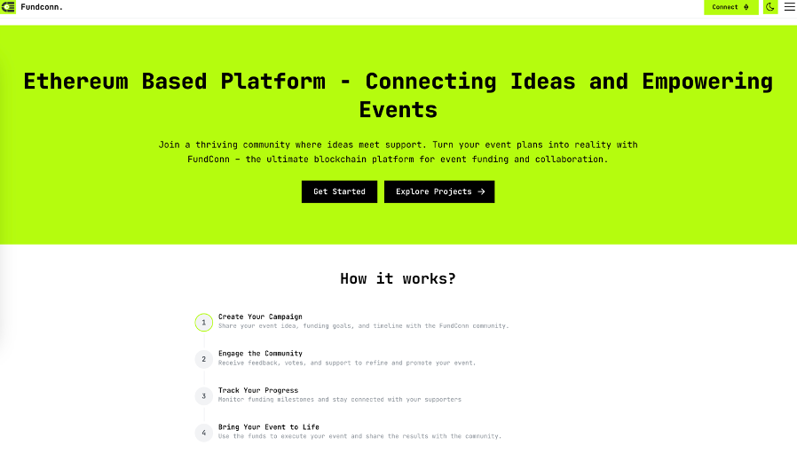
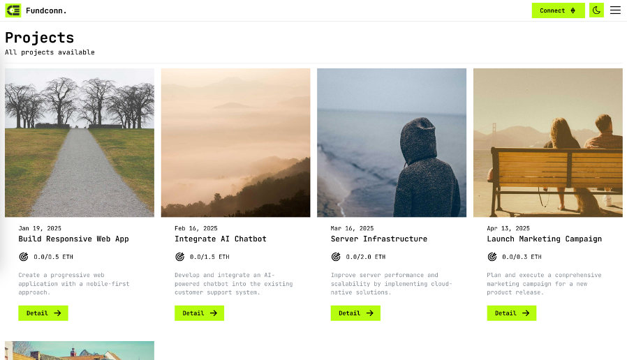
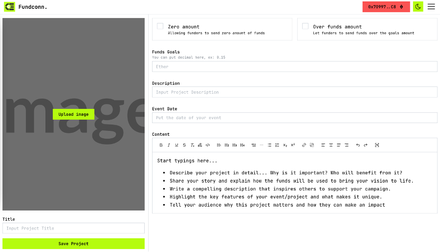

# FundConn


-65C2CB?style=flat-square&logo=ipfs&logoColor=white)


Decentralised event funding: a Solidity `EventFunding` contract (Hardhat), IPFS storage (Kubo) and a React + Vite frontend.

## Quick start

```bash
make build
make ipfs-config
```

App: http://localhost:3000. A browser wallet (MetaMask) is required to sign transactions; without one the app is read-only. See [Local development](docs/local-development.md), [Self-hosting](docs/self-hosting.md) and [Demo deployment](docs/demo.md).

## Setup

If you are developing a production application, we recommend you to:

- Start the server by using command, docker-compose up -d in this directory
- Then run `make ipfs-config`:

> Journal

- [Unreleased Paper](preview/paper.pdf)

## Architecture


## Preview





## License

Licensed under the [MIT License](LICENSE). See [SECURITY.md](SECURITY.md) for reporting vulnerabilities.
