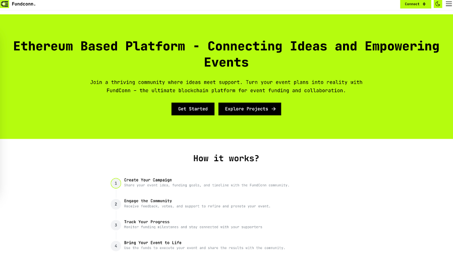
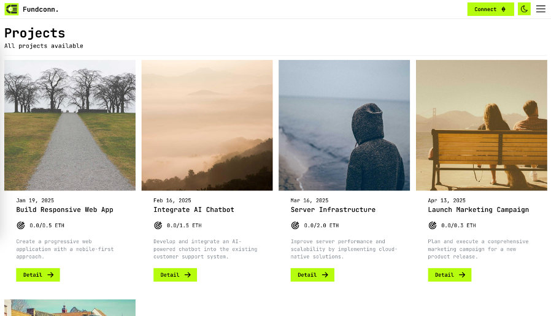
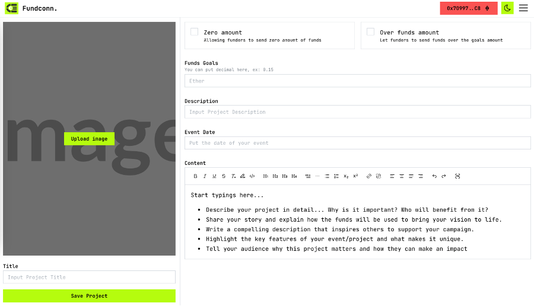
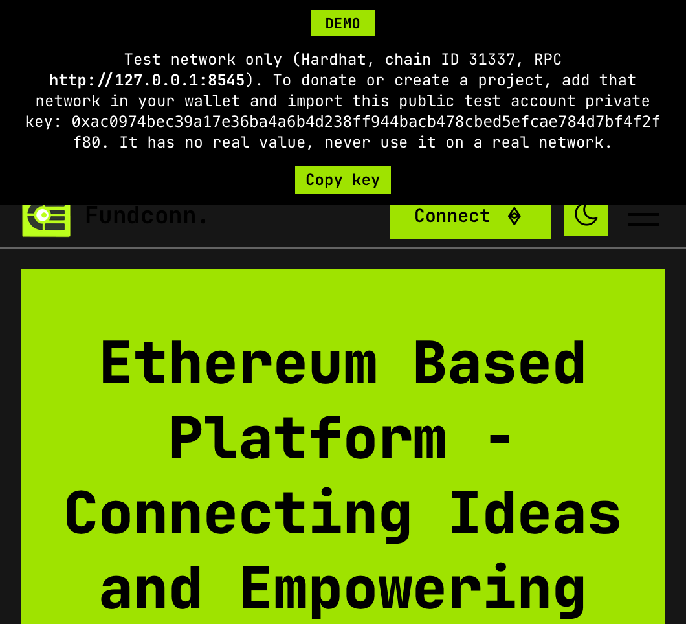
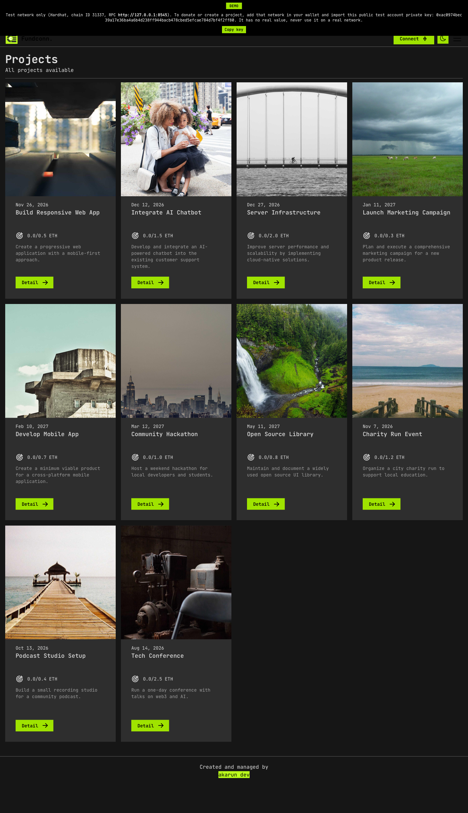
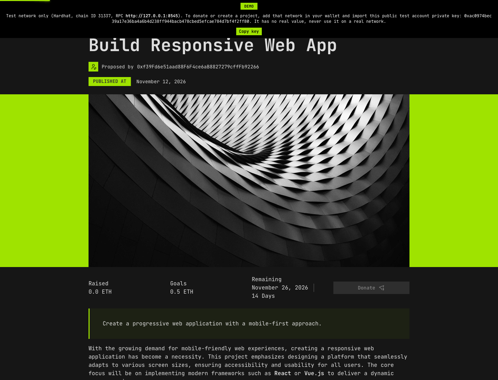
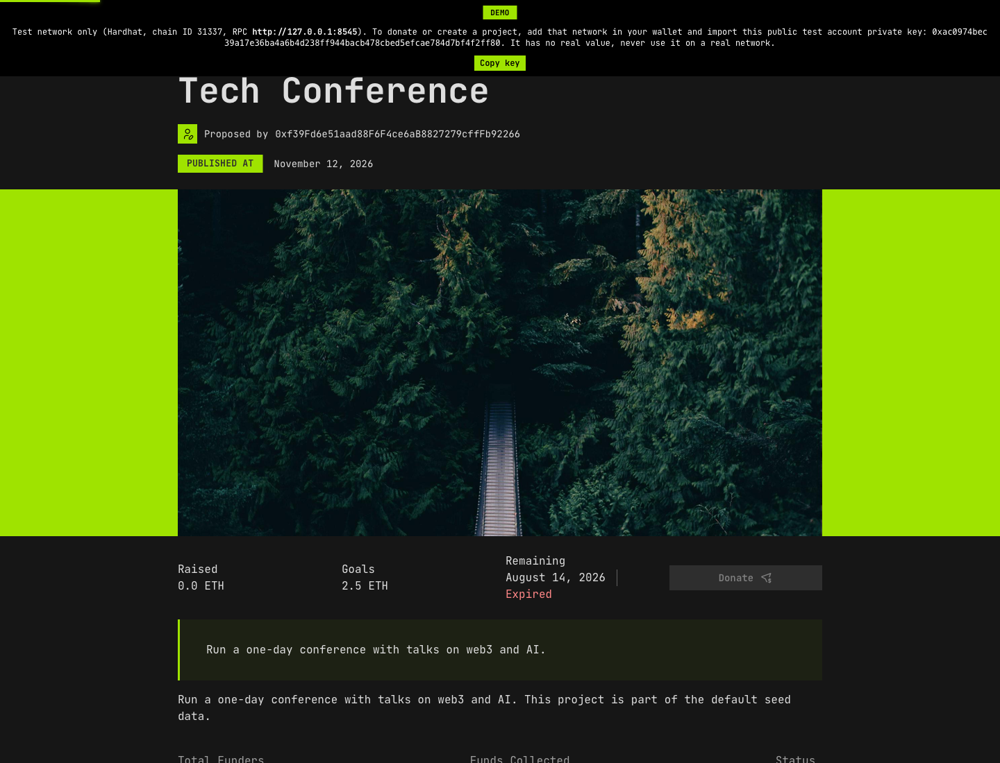

# Demo deployment

A demo runs the whole stack on a throwaway Hardhat chain with sample projects already in place, so visitors can try the app without any setup of your own. It holds no real value.

## Preview





## End-to-end walkthrough

Flows 1–4 were captured in the cmux browser on the local Hardhat chain. No wallet shim was used. The real-wallet flows (5–7) remain pending because this session could not access Chrome without opening or inspecting its existing tabs.






## What a demo contains

- **Backend:** the `backend` container starts `hardhat node` on `0.0.0.0:8545`, then `backend/docker-entrypoint.sh` runs `npm run deploy:dev`. That deploys `EventFunding` and seeds 10 sample projects: 7 active and 3 already expired, with deadlines relative to the start time (`backend/scripts/deploy.ts`).
- **Frontend:** built with `VITE_DEMO=true`, which shows a banner at the top of every page with the network details and the public test private key.
- **Persistence:** none. The chain is in memory, so every container restart wipes it and the entrypoint recreates the contract and the projects.

## Deploy with Docker Compose

```bash
docker compose up -d --build
```

The frontend is at http://localhost:3000. For the demo banner locally, set `VITE_DEMO=true` in `frontend/.env` (dev server) or pass it as a build argument.

## Deploy on Dokploy

See [Deploying on Dokploy](self-hosting.md#deploying-on-dokploy) for the domains and environment variables. Demo-specific settings:

| Variable | Value | Notes |
|---|---|---|
| `VITE_DEMO` | `true` (default in `docker-compose.dokploy.yml`) | Set `false` to hide the banner |
| `VITE_NETWORK` | `https://<backend domain>` | Must be HTTPS and reachable from browsers |
| `VITE_IPFS` | `https://<ipfs domain>/ipfs` | Public IPFS gateway |
| `VITE_CONTRACT_ADDRESS` | `0x5FbDB2315678afecb367f032d93F642f64180aa3` | Default; check the backend logs and change it if the deployed address differs |

All `VITE_*` values are baked in at build time, so rebuild after changing them.

## How visitors use the demo

1. **Browse:** the project list works without a wallet. It reads the chain through `VITE_NETWORK`.
2. **Use a wallet to donate or create projects.** Install a browser wallet (MetaMask or Coinbase Wallet). Then:
   1. Add a custom network: RPC `https://<backend domain>` (the one shown in the banner), chain ID `31337`, symbol `ETH`.
   2. Import the account with the private key shown in the banner (Copy key button). It is Hardhat's public default account #0 and holds 10000 test ETH.
   3. Select that network, connect on the site, and donate.

More detail, including wallet-specific checks and troubleshooting, is in [Local development](local-development.md#wallet-setup-metamask-coinbase-wallet-or-any-windowethereum-wallet).

## Limits and cautions

- The test key is public and anyone can spend from its accounts. Never use it, or this chain, for real funds.
- Account #0 deployed the contract and owns every seeded project. Donating from it sends ETH back to itself. Importing account #1 (`0x7099…79C8`) avoids that.
- The 3 expired projects show "Expired" and cannot be donated to. The contract itself does not enforce deadlines; the block is in the UI only.
- After a restart the wallet may hold a stale nonce and fail with `nonce too low`. Remove and re-add the network, or switch accounts.
- Do not expose the IPFS API (port 5001).
